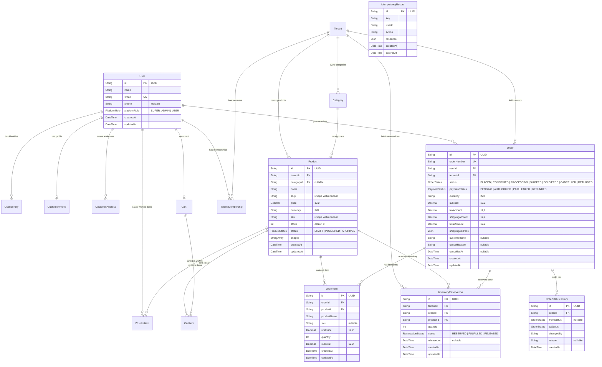

# GauShilp OS — Database Schema Documentation

**Version:** 1.9 (Step 13: Performance, Caching, Database Optimisation and Load Testing)  
**Database:** PostgreSQL  
**ORM:** Prisma  

---

## 1. Overview & Multi-Tenant Model

GauShilp OS uses a **shared-database, tenant-scoped schema** model. Every tenant represents an independent seller storefront.

### Core Isolation Rules
1. **User Identity vs Tenant Membership**: Platform user accounts (`User`) and external OIDC identities (`UserIdentity`) are distinct from store roles. A single user can belong to multiple tenants (e.g. `STORE_OWNER` of Store A, and `CUSTOMER` of Store B).
2. **Duplicate Prevention**: The compound unique constraint `@@unique([userId, tenantId])` on `tenant_memberships` prevents a user from having duplicate memberships in the same tenant.
3. **Product & Category Scoping**: Every product and category belongs strictly to a single `tenantId`. Categories and products cannot cross tenant boundaries.
4. **Customer Isolation**: Customer profiles, delivery addresses, wishlist items, and customer orders belong strictly to the authenticated `userId`.
5. **Platform Administration**: `SUPER_ADMIN` is a platform-level role on the `User` model, separate from tenant memberships. Super admins do not have automatic or implicit access to every tenant store.
6. **Cart Ownership & Stock Safety**: Each registered customer has a single active `Cart` record (`userId` unique constraint). Cart storage does not reserve inventory.
7. **Atomic Inventory Reservation & Exactly-Once Restoration**: Orders deduct available product stock using conditional update row locks (`stock >= quantity`) and record corresponding `InventoryReservation` rows (`RESERVED`). Order cancellations transition reservations to `RELEASED` and safely restore stock exactly once.
8. **Idempotency Protection**: Repeated network submissions containing identical idempotency keys return the existing processed order without duplicate order creation or double-decrementing stock.
9. **File & Asset Tenant Scoping**: Every uploaded file (`StoredFile`) is tied to the uploading `userId` and associated `tenantId`. Object keys are deterministic and server-controlled (`tenants/{tenantId}/{purpose}/{uuid}.{ext}`). Direct deletion or attachment to products/stores requires tenant ownership validation and active reference verification.

---

## 2. Entity Relationship Diagram (ERD)

---

## 3. Data Dictionary

### 3.1 `users`
Represents verified user identities on the platform.

| Column | Type | Constraints | Description |
|---|---|---|---|
| `id` | `TEXT (UUID)` | `PRIMARY KEY` | Globally unique identifier |
| `name` | `TEXT` | `NOT NULL` | Full name of the user |
| `email` | `TEXT` | `NOT NULL, UNIQUE` | Unique email for authentication |
| `phone` | `TEXT` | `NULLABLE` | Contact phone number |
| `platformRole` | `PlatformRole` | `NOT NULL, DEFAULT 'USER'` | `SUPER_ADMIN` or `USER` |
| `status` | `UserStatus` | `NOT NULL, DEFAULT 'ACTIVE'` | Account status: `ACTIVE`, `SUSPENDED` |
| `suspendedAt` | `TIMESTAMP` | `NULLABLE` | Timestamp when user was suspended |
| `suspensionReason` | `TEXT` | `NULLABLE` | Reason recorded for administrative account suspension |
| `createdAt` | `TIMESTAMP` | `DEFAULT now()` | Record creation timestamp |
| `updatedAt` | `TIMESTAMP` | `AUTO UPDATE` | Last modification timestamp |

*Indexes:*
* `@@index([status])` — Fast filtering of active vs suspended users
* `@@index([platformRole])` — Administrative inspection of Super Admins

### 3.2 `customer_profiles`
Customer-specific profile attributes and account deactivation status.

| Column | Type | Constraints | Description |
|---|---|---|---|
| `id` | `TEXT (UUID)` | `PRIMARY KEY` | Profile ID |
| `userId` | `TEXT (UUID)` | `FK -> users(id) ON DELETE CASCADE, UNIQUE` | Owning customer user |
| `avatarUrl` | `TEXT` | `NULLABLE` | Customer profile avatar image URL |
| `bio` | `TEXT` | `NULLABLE` | Short biography or buyer preferences |
| `dateOfBirth` | `TIMESTAMP` | `NULLABLE` | Customer birth date |
| `preferences` | `JSONB` | `NULLABLE` | Notification & buyer UI preferences |
| `isActive` | `BOOLEAN` | `NOT NULL, DEFAULT true` | Account active flag |
| `deactivatedAt` | `TIMESTAMP` | `NULLABLE` | Deactivation timestamp |
| `createdAt` | `TIMESTAMP` | `DEFAULT now()` | Record creation timestamp |
| `updatedAt` | `TIMESTAMP` | `AUTO UPDATE` | Last modification timestamp |

### 3.3 `customer_addresses`
Saved customer delivery and billing addresses.

| Column | Type | Constraints | Description |
|---|---|---|---|
| `id` | `TEXT (UUID)` | `PRIMARY KEY` | Address ID |
| `userId` | `TEXT (UUID)` | `FK -> users(id) ON DELETE CASCADE` | Owning customer user |
| `fullName` | `TEXT` | `NOT NULL` | Recipient full name |
| `phone` | `TEXT` | `NOT NULL` | Contact delivery phone number |
| `addressLine1` | `TEXT` | `NOT NULL` | Street address, flat, or building |
| `addressLine2` | `TEXT` | `NULLABLE` | Secondary address, landmark, sector |
| `city` | `TEXT` | `NOT NULL` | City or town |
| `state` | `TEXT` | `NOT NULL` | State or province |
| `postalCode` | `TEXT` | `NOT NULL` | Postal PIN code (3-10 alphanumeric) |
| `country` | `TEXT` | `NOT NULL, DEFAULT 'IN'` | Country code or name |
| `landmark` | `TEXT` | `NULLABLE` | Nearby navigation landmark |
| `isDefault` | `BOOLEAN` | `NOT NULL, DEFAULT false` | Primary default address for orders |
| `addressType` | `TEXT` | `NOT NULL, DEFAULT 'HOME'` | Classification: `HOME`, `WORK`, `OTHER` |
| `createdAt` | `TIMESTAMP` | `DEFAULT now()` | Record creation timestamp |
| `updatedAt` | `TIMESTAMP` | `AUTO UPDATE` | Last modification timestamp |

*Index:* `@@index([userId])`

### 3.4 `wishlist_items`
Customer saved products for later purchase.

| Column | Type | Constraints | Description |
|---|---|---|---|
| `id` | `TEXT (UUID)` | `PRIMARY KEY` | Wishlist item ID |
| `userId` | `TEXT (UUID)` | `FK -> users(id) ON DELETE CASCADE` | Customer owner |
| `productId` | `TEXT (UUID)` | `FK -> products(id) ON DELETE CASCADE` | Saved product |
| `createdAt` | `TIMESTAMP` | `DEFAULT now()` | Saved timestamp |
| `updatedAt` | `TIMESTAMP` | `AUTO UPDATE` | Last modification timestamp |

*Constraints & Indexes:*
* `@@unique([userId, productId])` — Prevents duplicate wishlist entries per customer.
* `@@index([userId])`
* `@@index([productId])`

### 3.5 `carts`
Customer shopping cart container. Designed to allow guest carts in the future (`userId` is nullable).

| Column | Type | Constraints | Description |
|---|---|---|---|
| `id` | `TEXT (UUID)` | `PRIMARY KEY` | Cart record ID |
| `userId` | `TEXT (UUID)` | `FK -> users(id) ON DELETE CASCADE, UNIQUE, NULLABLE` | Registered customer owner |
| `currency` | `TEXT` | `NOT NULL, DEFAULT 'INR'` | Operating currency for the cart |
| `createdAt` | `TIMESTAMP` | `DEFAULT now()` | Cart creation timestamp |
| `updatedAt` | `TIMESTAMP` | `AUTO UPDATE` | Last modification timestamp |

### 3.6 `cart_items`
Individual product line items within a shopping cart.

| Column | Type | Constraints | Description |
|---|---|---|---|
| `id` | `TEXT (UUID)` | `PRIMARY KEY` | Cart item ID |
| `cartId` | `TEXT (UUID)` | `FK -> carts(id) ON DELETE CASCADE` | Owning cart |
| `productId` | `TEXT (UUID)` | `FK -> products(id) ON DELETE CASCADE` | Product added to cart |
| `quantity` | `INTEGER` | `NOT NULL, DEFAULT 1` | Quantity ordered (1-50 limit) |
| `priceSnapshot` | `DECIMAL(12,2)` | `NULLABLE` | Historical price recorded when added (detects price changes) |
| `createdAt` | `TIMESTAMP` | `DEFAULT now()` | Item added timestamp |
| `updatedAt` | `TIMESTAMP` | `AUTO UPDATE` | Last modification timestamp |

*Constraints & Indexes:*
* `@@unique([cartId, productId])` — Prevents duplicate cart rows for the same product.
* `@@index([cartId])`
* `@@index([productId])`

### 3.7 `tenants`
Represents an individual seller business / storefront.

| Column | Type | Constraints | Description |
|---|---|---|---|
| `id` | `TEXT (UUID)` | `PRIMARY KEY` | Globally unique tenant identifier |
| `businessName` | `TEXT` | `NOT NULL` | Business / store name |
| `storeSlug` | `TEXT` | `NOT NULL, UNIQUE` | Unique subdomain / URL path identifier |
| `description` | `TEXT` | `NULLABLE` | Store bio and story |
| `logoUrl` | `TEXT` | `NULLABLE` | Store logo image URL |
| `bannerUrl` | `TEXT` | `NULLABLE` | Storefront banner image URL |
| `contactEmail` | `TEXT` | `NULLABLE` | Store public customer support email |
| `contactPhone` | `TEXT` | `NULLABLE` | Store public customer support phone |
| `address` | `TEXT` | `NULLABLE` | Store physical / shipping address |
| `currency` | `TEXT` | `NOT NULL, DEFAULT 'INR'` | Default currency code |
| `isPublished` | `BOOLEAN` | `NOT NULL, DEFAULT false` | Publish status for public visitors |
| `publishedAt` | `TIMESTAMP` | `NULLABLE` | Timestamp when store was published |
| `status` | `TenantStatus` | `NOT NULL, DEFAULT 'ACTIVE'` | `ACTIVE`, `SUSPENDED`, `PENDING` |
| `createdAt` | `TIMESTAMP` | `DEFAULT now()` | Registration timestamp |
| `updatedAt` | `TIMESTAMP` | `AUTO UPDATE` | Last modification timestamp |

*Indexes:*
* `@@index([status])` — Platform administrative filtering of active vs suspended stores
* `@@index([createdAt])` — Platform analytics query aggregation by registration date

### 3.8 `categories`
Product categorization scoped to a single tenant.

| Column | Type | Constraints | Description |
|---|---|---|---|
| `id` | `TEXT (UUID)` | `PRIMARY KEY` | Category record ID |
| `tenantId` | `TEXT (UUID)` | `FK -> tenants(id) ON DELETE CASCADE` | Owning store |
| `name` | `TEXT` | `NOT NULL` | Category name |
| `slug` | `TEXT` | `NOT NULL` | URL-friendly slug |
| `description` | `TEXT` | `NULLABLE` | Category description |
| `createdAt` | `TIMESTAMP` | `DEFAULT now()` | Creation timestamp |
| `updatedAt` | `TIMESTAMP` | `AUTO UPDATE` | Last modification timestamp |

*Constraints & Indexes:*
* `@@unique([tenantId, slug])` — Category slug unique per store.
* `@@index([tenantId])`

### 3.9 `products`
Seller product catalogue items with atomic stock quantities.

| Column | Type | Constraints | Description |
|---|---|---|---|
| `id` | `TEXT (UUID)` | `PRIMARY KEY` | Product ID |
| `tenantId` | `TEXT (UUID)` | `FK -> tenants(id) ON DELETE CASCADE` | Owning store |
| `categoryId` | `TEXT (UUID)` | `FK -> categories(id) ON DELETE SET NULL` | Assigned category |
| `name` | `TEXT` | `NOT NULL` | Product title |
| `slug` | `TEXT` | `NOT NULL` | URL-friendly product slug |
| `description` | `TEXT` | `NULLABLE` | Product details and specifications |
| `price` | `DECIMAL(12,2)` | `NOT NULL` | Base price (must be >= 0) |
| `currency` | `TEXT` | `NOT NULL, DEFAULT 'INR'` | Currency code |
| `sku` | `TEXT` | `NULLABLE` | Stock Keeping Unit |
| `stock` | `INTEGER` | `NOT NULL, DEFAULT 0` | Available inventory stock count |
| `status` | `ProductStatus` | `NOT NULL, DEFAULT 'DRAFT'` | `DRAFT`, `PUBLISHED`, `ARCHIVED` |
| `images` | `TEXT[]` | `NOT NULL, DEFAULT []` | Object storage keys / image URLs |
| `createdAt` | `TIMESTAMP` | `DEFAULT now()` | Creation timestamp |
| `updatedAt` | `TIMESTAMP` | `AUTO UPDATE` | Last modification timestamp |

*Constraints & Indexes:*
* `@@unique([tenantId, slug])` — Product slug unique per store.
* `@@unique([tenantId, sku])` — SKU unique per store.
* `@@index([tenantId, status])` — Fast filtering of published products.
* `@@index([tenantId, categoryId])` — Fast lookups by category.

### 3.10 `orders`
Customer purchase order header.

| Column | Type | Constraints | Description |
|---|---|---|---|
| `id` | `TEXT (UUID)` | `PRIMARY KEY` | Order ID |
| `orderNumber` | `TEXT` | `NOT NULL, UNIQUE` | Collision-resistant human-readable order number (`GS-YYYYMMDD-XXXXX`) |
| `userId` | `TEXT (UUID)` | `FK -> users(id) ON DELETE RESTRICT` | Purchasing customer |
| `tenantId` | `TEXT (UUID)` | `FK -> tenants(id) ON DELETE RESTRICT` | Seller store fulfilling order |
| `status` | `OrderStatus` | `NOT NULL, DEFAULT 'PLACED'` | `PLACED`, `CONFIRMED`, `PROCESSING`, `SHIPPED`, `DELIVERED`, `CANCELLED`, `RETURNED` |
| `paymentStatus` | `PaymentStatus` | `NOT NULL, DEFAULT 'PENDING'` | `PENDING`, `AUTHORIZED`, `PAID`, `FAILED`, `REFUNDED` |
| `currency` | `TEXT` | `NOT NULL, DEFAULT 'INR'` | Operating currency |
| `subtotal` | `DECIMAL(12,2)` | `NOT NULL` | Line-items subtotal (server-calculated) |
| `taxAmount` | `DECIMAL(12,2)` | `NOT NULL, DEFAULT 0` | Total tax amount |
| `shippingAmount` | `DECIMAL(12,2)` | `NOT NULL, DEFAULT 0` | Total delivery/shipping charge |
| `totalAmount` | `DECIMAL(12,2)` | `NOT NULL` | Final calculated order payable total |
| `shippingAddress` | `JSONB` | `NOT NULL` | Immutable snapshot of recipient delivery address |
| `customerNote` | `TEXT` | `NULLABLE` | Special delivery instructions from customer |
| `cancelReason` | `TEXT` | `NULLABLE` | Reason recorded if order is cancelled |
| `cancelledAt` | `TIMESTAMP` | `NULLABLE` | Timestamp of cancellation |
| `createdAt` | `TIMESTAMP` | `DEFAULT now()` | Creation timestamp |
| `updatedAt` | `TIMESTAMP` | `AUTO UPDATE` | Last modification timestamp |

*Constraints & Indexes:*
* `@@unique([orderNumber])`
* `@@index([userId])`
* `@@index([tenantId])`
* `@@index([tenantId, status])`
* `@@index([createdAt])`

### 3.11 `order_items`
Immutable line-item snapshots for an order.

| Column | Type | Constraints | Description |
|---|---|---|---|
| `id` | `TEXT (UUID)` | `PRIMARY KEY` | Line item ID |
| `orderId` | `TEXT (UUID)` | `FK -> orders(id) ON DELETE CASCADE` | Parent order |
| `productId` | `TEXT (UUID)` | `FK -> products(id) ON DELETE RESTRICT` | Product purchased |
| `productName` | `TEXT` | `NOT NULL` | Immutable snapshot of product title |
| `sku` | `TEXT` | `NULLABLE` | Immutable snapshot of product SKU |
| `unitPrice` | `DECIMAL(12,2)` | `NOT NULL` | Immutable unit price at time of order |
| `quantity` | `INTEGER` | `NOT NULL` | Quantity purchased |
| `subtotal` | `DECIMAL(12,2)` | `NOT NULL` | Line subtotal (`unitPrice * quantity`) |
| `createdAt` | `TIMESTAMP` | `DEFAULT now()` | Creation timestamp |
| `updatedAt` | `TIMESTAMP` | `AUTO UPDATE` | Last modification timestamp |

*Indexes:*
* `@@index([orderId])`
* `@@index([productId])`

### 3.12 `inventory_reservations`
Tracks stock reservations for pending and fulfilled orders.

| Column | Type | Constraints | Description |
|---|---|---|---|
| `id` | `TEXT (UUID)` | `PRIMARY KEY` | Reservation record ID |
| `tenantId` | `TEXT (UUID)` | `FK -> tenants(id) ON DELETE CASCADE` | Seller store |
| `orderId` | `TEXT (UUID)` | `FK -> orders(id) ON DELETE CASCADE` | Associated order |
| `productId` | `TEXT (UUID)` | `FK -> products(id) ON DELETE CASCADE` | Reserved product |
| `quantity` | `INTEGER` | `NOT NULL` | Reserved quantity count |
| `status` | `ReservationStatus` | `NOT NULL, DEFAULT 'RESERVED'` | `RESERVED`, `FULFILLED`, `RELEASED` |
| `releasedAt` | `TIMESTAMP` | `NULLABLE` | Timestamp when reservation was released / stock restored |
| `createdAt` | `TIMESTAMP` | `DEFAULT now()` | Reservation timestamp |
| `updatedAt` | `TIMESTAMP` | `AUTO UPDATE` | Last modification timestamp |

*Indexes:*
* `@@index([tenantId])`
* `@@index([orderId])`
* `@@index([productId, status])`

### 3.13 `order_status_history`
Audit log of all order lifecycle status transitions.

| Column | Type | Constraints | Description |
|---|---|---|---|
| `id` | `TEXT (UUID)` | `PRIMARY KEY` | History entry ID |
| `orderId` | `TEXT (UUID)` | `FK -> orders(id) ON DELETE CASCADE` | Order |
| `fromStatus` | `OrderStatus` | `NULLABLE` | Previous status (null on order placement) |
| `toStatus` | `OrderStatus` | `NOT NULL` | Newly transitioned status |
| `changedBy` | `TEXT` | `NOT NULL` | User UUID who initiated change, or `'SYSTEM'` |
| `reason` | `TEXT` | `NULLABLE` | Status transition or fulfillment reason |
| `createdAt` | `TIMESTAMP` | `DEFAULT now()` | Transition timestamp |

*Index:* `@@index([orderId])`

### 3.14 `idempotency_records`
Ensures duplicate request submissions with identical idempotency keys return cached responses safely.

| Column | Type | Constraints | Description |
|---|---|---|---|
| `id` | `TEXT (UUID)` | `PRIMARY KEY` | Idempotency record ID |
| `key` | `TEXT` | `NOT NULL` | Client-supplied idempotency key |
| `userId` | `TEXT` | `NOT NULL` | Authenticated caller user ID |
| `action` | `TEXT` | `NOT NULL` | Scoped API operation (`CREATE_ORDER`) |
| `response` | `JSONB` | `NOT NULL` | Cached JSON response payload |
| `createdAt` | `TIMESTAMP` | `DEFAULT now()` | Request timestamp |
| `expiresAt` | `TIMESTAMP` | `NOT NULL` | Expiration timestamp (24h retention) |

*Constraints & Indexes:*
* `@@unique([userId, key, action])` — Guarantees atomic deduplication per user.
* `@@index([expiresAt])`

### 3.15 `payment_records`
Core financial record for customer-to-seller orders. Scoped to store tenant and customer user.

| Column | Type | Constraints | Description |
|---|---|---|---|
| `id` | `TEXT (UUID)` | `PRIMARY KEY` | Payment record identifier |
| `orderId` | `TEXT (UUID)` | `FK -> orders(id) ON DELETE RESTRICT` | Associated order |
| `tenantId` | `TEXT (UUID)` | `FK -> tenants(id) ON DELETE RESTRICT` | Seller store tenant |
| `userId` | `TEXT (UUID)` | `FK -> users(id) ON DELETE RESTRICT` | Customer who initiated payment |
| `provider` | `TEXT` | `NOT NULL, DEFAULT 'sandbox'` | Provider identifier (e.g. `sandbox`, `razorpay`, `stripe`) |
| `providerPaymentId` | `TEXT` | `NULLABLE` | Gateway transaction/charge ID |
| `providerOrderId` | `TEXT` | `NULLABLE` | Gateway order/session ID |
| `amount` | `DECIMAL(12,2)` | `NOT NULL` | Payable amount |
| `currency` | `TEXT` | `NOT NULL, DEFAULT 'INR'` | Currency code |
| `status` | `PaymentRecordStatus` | `NOT NULL, DEFAULT 'PENDING'` | `PENDING`, `REQUIRES_ACTION`, `SUCCEEDED`, `FAILED`, `CANCELLED`, `REFUNDED`, `PARTIALLY_REFUNDED` |
| `paymentMethod` | `TEXT` | `NULLABLE` | Payment channel (`card`, `upi`, `netbanking`, etc.) |
| `errorMessage` | `TEXT` | `NULLABLE` | Gateway error code or reconciliation message |
| `paidAt` | `TIMESTAMP` | `NULLABLE` | Timestamp when payment was verified |
| `createdAt` | `TIMESTAMP` | `DEFAULT now()` | Creation timestamp |
| `updatedAt` | `TIMESTAMP` | `AUTO UPDATE` | Last modification timestamp |

*Indexes:*
* `@@index([orderId])`
* `@@index([tenantId])`
* `@@index([userId])`
* `@@index([providerPaymentId])`
* `@@index([status])`

### 3.16 `payment_attempts`
Historical log of each payment submission attempt for a payment record.

| Column | Type | Constraints | Description |
|---|---|---|---|
| `id` | `TEXT (UUID)` | `PRIMARY KEY` | Attempt identifier |
| `paymentRecordId` | `TEXT (UUID)` | `FK -> payment_records(id) ON DELETE CASCADE` | Parent payment record |
| `attemptNumber` | `INTEGER` | `NOT NULL, DEFAULT 1` | Sequential attempt counter |
| `providerReference` | `TEXT` | `NULLABLE` | Provider transaction reference |
| `status` | `PaymentRecordStatus` | `NOT NULL, DEFAULT 'PENDING'` | Result status of attempt |
| `amount` | `DECIMAL(12,2)` | `NOT NULL` | Attempted amount |
| `currency` | `TEXT` | `NOT NULL, DEFAULT 'INR'` | Attempted currency |
| `rawResponse` | `JSONB` | `NULLABLE` | Raw gateway payload snapshot |
| `failureReason` | `TEXT` | `NULLABLE` | Gateway failure message |
| `createdAt` | `TIMESTAMP` | `DEFAULT now()` | Attempt timestamp |

*Index:* `@@index([paymentRecordId])`

### 3.17 `refund_records`
Audit log of authorized full or partial refunds for customer payments.

| Column | Type | Constraints | Description |
|---|---|---|---|
| `id` | `TEXT (UUID)` | `PRIMARY KEY` | Refund record identifier |
| `paymentRecordId` | `TEXT (UUID)` | `FK -> payment_records(id) ON DELETE CASCADE` | Source payment record |
| `orderId` | `TEXT (UUID)` | `FK -> orders(id) ON DELETE RESTRICT` | Associated order |
| `tenantId` | `TEXT (UUID)` | `FK -> tenants(id) ON DELETE RESTRICT` | Store tenant |
| `amount` | `DECIMAL(12,2)` | `NOT NULL` | Refunded amount |
| `currency` | `TEXT` | `NOT NULL, DEFAULT 'INR'` | Currency code |
| `providerRefundId` | `TEXT` | `NULLABLE` | Gateway refund identifier |
| `reason` | `TEXT` | `NULLABLE` | Business justification for refund |
| `status` | `RefundStatus` | `NOT NULL, DEFAULT 'PENDING'` | `PENDING`, `SUCCEEDED`, `FAILED` |
| `createdAt` | `TIMESTAMP` | `DEFAULT now()` | Timestamp |
| `updatedAt` | `TIMESTAMP` | `AUTO UPDATE` | Last update |

*Indexes:*
* `@@index([paymentRecordId])`
* `@@index([orderId])`
* `@@index([tenantId])`

### 3.18 `payment_webhook_events`
Idempotency and replay-prevention log for payment and subscription webhooks.

| Column | Type | Constraints | Description |
|---|---|---|---|
| `id` | `TEXT (UUID)` | `PRIMARY KEY` | Webhook log identifier |
| `provider` | `TEXT` | `NOT NULL` | Webhook provider (`sandbox`, `razorpay`, `stripe`) |
| `eventId` | `TEXT` | `NOT NULL` | Provider unique event identifier |
| `eventType` | `TEXT` | `NOT NULL` | Event action type (`payment.succeeded`, `subscription.renewed`) |
| `payload` | `JSONB` | `NOT NULL` | Complete raw webhook payload |
| `processed` | `BOOLEAN` | `NOT NULL, DEFAULT true` | Processing status flag |
| `processedAt` | `TIMESTAMP` | `DEFAULT now()` | Processing timestamp |
| `error` | `TEXT` | `NULLABLE` | Processing error details if failed |
| `createdAt` | `TIMESTAMP` | `DEFAULT now()` | Ingestion timestamp |

*Constraints & Indexes:*
* `@@unique([provider, eventId])` — Guarantees atomic replay protection
* `@@index([eventType])`

### 3.19 `subscription_plans`
SaaS tier catalog defining pricing, resource quotas, and platform features.

| Column | Type | Constraints | Description |
|---|---|---|---|
| `id` | `TEXT (UUID)` | `PRIMARY KEY` | Plan identifier |
| `name` | `TEXT` | `NOT NULL` | Human-readable name (e.g., Starter Artisan, Growth Gaushala, Pro Guild) |
| `slug` | `TEXT` | `UNIQUE, NOT NULL` | URL-safe identifier (`starter`, `growth`, `pro`) |
| `description` | `TEXT` | `NULLABLE` | Plan description |
| `priceMonthly` | `DECIMAL(12,2)` | `NOT NULL` | Monthly billing price in INR |
| `priceAnnual` | `DECIMAL(12,2)` | `NOT NULL` | Annual billing price in INR |
| `currency` | `TEXT` | `NOT NULL, DEFAULT 'INR'` | Billing currency |
| `maxProducts` | `INTEGER` | `NOT NULL, DEFAULT 50` | Entitlement: Maximum active products allowed |
| `maxStaffMembers` | `INTEGER` | `NOT NULL, DEFAULT 2` | Entitlement: Maximum staff seats allowed |
| `customDomainEnabled` | `BOOLEAN` | `NOT NULL, DEFAULT false` | Entitlement: Custom domain feature flag |
| `analyticsEnabled` | `BOOLEAN` | `NOT NULL, DEFAULT false` | Entitlement: Advanced analytics feature flag |
| `prioritySupport` | `BOOLEAN` | `NOT NULL, DEFAULT false` | Entitlement: Priority SLA support flag |
| `isActive` | `BOOLEAN` | `NOT NULL, DEFAULT true` | Plan availability flag |
| `createdAt` | `TIMESTAMP` | `DEFAULT now()` | Creation timestamp |
| `updatedAt` | `TIMESTAMP` | `AUTO UPDATE` | Last modification timestamp |

### 3.20 `subscriptions`
Tenant subscription state connecting a store to their active SaaS billing tier.

| Column | Type | Constraints | Description |
|---|---|---|---|
| `id` | `TEXT (UUID)` | `PRIMARY KEY` | Subscription identifier |
| `tenantId` | `TEXT (UUID)` | `UNIQUE, FK -> tenants(id) ON DELETE CASCADE` | Associated store tenant |
| `planId` | `TEXT (UUID)` | `FK -> subscription_plans(id) ON DELETE RESTRICT` | Subscribed tier |
| `status` | `SubscriptionStatus` | `NOT NULL, DEFAULT 'ACTIVE'` | `TRIALING`, `ACTIVE`, `PAST_DUE`, `CANCELLED`, `EXPIRED`, `SUSPENDED` |
| `billingInterval` | `BillingInterval` | `NOT NULL, DEFAULT 'MONTHLY'` | `MONTHLY`, `ANNUAL` |
| `currentPeriodStart` | `TIMESTAMP` | `NOT NULL` | Start timestamp of active billing period |
| `currentPeriodEnd` | `TIMESTAMP` | `NOT NULL` | End timestamp of active billing period |
| `cancelAtPeriodEnd` | `BOOLEAN` | `NOT NULL, DEFAULT false` | Flag if cancellation scheduled at period end |
| `cancelledAt` | `TIMESTAMP` | `NULLABLE` | Timestamp when cancellation was requested |
| `providerSubscriptionId` | `TEXT` | `NULLABLE` | Gateway subscription identifier |
| `providerCustomerId` | `TEXT` | `NULLABLE` | Gateway customer identifier |
| `createdAt` | `TIMESTAMP` | `DEFAULT now()` | Creation timestamp |
| `updatedAt` | `TIMESTAMP` | `AUTO UPDATE` | Last modification timestamp |

*Constraints & Indexes:*
* `@@unique([tenantId])`
* `@@index([planId])`
* `@@index([status])`

### 3.21 `subscription_invoices`
SaaS billing history for platform software usage subscriptions. Completely separate from customer orders.

| Column | Type | Constraints | Description |
|---|---|---|---|
| `id` | `TEXT (UUID)` | `PRIMARY KEY` | Invoice identifier |
| `subscriptionId` | `TEXT (UUID)` | `FK -> subscriptions(id) ON DELETE CASCADE` | Parent subscription |
| `tenantId` | `TEXT (UUID)` | `FK -> tenants(id) ON DELETE CASCADE` | Store tenant billed |
| `invoiceNumber` | `TEXT` | `UNIQUE, NOT NULL` | Unique sequential billing invoice number |
| `amount` | `DECIMAL(12,2)` | `NOT NULL` | Billed amount |
| `currency` | `TEXT` | `NOT NULL, DEFAULT 'INR'` | Currency |
| `status` | `TEXT` | `NOT NULL, DEFAULT 'PAID'` | Invoice payment status (`PAID`, `FAILED`) |
| `billingReason` | `TEXT` | `NULLABLE` | Description of charge |
| `periodStart` | `TIMESTAMP` | `NOT NULL` | Period start covered |
| `periodEnd` | `TIMESTAMP` | `NOT NULL` | Period end covered |
| `paidAt` | `TIMESTAMP` | `NULLABLE` | Payment timestamp |
| `providerInvoiceId` | `TEXT` | `NULLABLE` | Gateway invoice identifier |
| `createdAt` | `TIMESTAMP` | `DEFAULT now()` | Timestamp |

*Constraints & Indexes:*
* `@@unique([invoiceNumber])`
* `@@index([subscriptionId])`
* `@@index([tenantId])`

### 3.22 `shipping_records`
Physical package shipment record linking an order to a shipping carrier. Scoped to store tenant.

| Column | Type | Constraints | Description |
|---|---|---|---|
| `id` | `TEXT (UUID)` | `PRIMARY KEY` | Shipment record identifier |
| `tenantId` | `TEXT (UUID)` | `FK -> tenants(id) ON DELETE CASCADE` | Owning store tenant |
| `orderId` | `TEXT (UUID)` | `FK -> orders(id) ON DELETE CASCADE` | Associated order |
| `provider` | `TEXT` | `NOT NULL, DEFAULT 'sandbox'` | Carrier/provider (e.g. `sandbox`, `delhivery`, `shiprocket`) |
| `trackingNumber` | `TEXT` | `NULLABLE` | Carrier tracking number / AWB code |
| `status` | `ShipmentStatus` | `NOT NULL, DEFAULT 'PENDING'` | `PENDING`, `READY_TO_SHIP`, `SHIPPED`, `IN_TRANSIT`, `OUT_FOR_DELIVERY`, `DELIVERED`, `DELIVERY_FAILED`, `RETURN_TO_ORIGIN`, `CANCELLED` |
| `packageWeight` | `DECIMAL(10,2)` | `NOT NULL` | Actual packed weight in kilograms |
| `packageLength` | `DECIMAL(10,2)` | `NULLABLE` | Package length in cm |
| `packageWidth` | `DECIMAL(10,2)` | `NULLABLE` | Package width in cm |
| `packageHeight` | `DECIMAL(10,2)` | `NULLABLE` | Package height in cm |
| `shippingCost` | `DECIMAL(12,2)` | `NOT NULL, DEFAULT 0` | Actual fulfillment cost incurred with carrier (separate from customer charge) |
| `currency` | `TEXT` | `NOT NULL, DEFAULT 'INR'` | Operating currency |
| `shippedAt` | `TIMESTAMP` | `NULLABLE` | Timestamp when package dispatched |
| `deliveredAt` | `TIMESTAMP` | `NULLABLE` | Timestamp when package delivered |
| `carrierNote` | `TEXT` | `NULLABLE` | Seller dispatch instructions or fragile item warning |
| `createdAt` | `TIMESTAMP` | `DEFAULT now()` | Creation timestamp |
| `updatedAt` | `TIMESTAMP` | `AUTO UPDATE` | Last modification timestamp |

*Constraints & Indexes:*
* `@@index([tenantId])` — Store tenant isolation
* `@@index([orderId])` — Fast lookup for order shipments
* `@@index([trackingNumber])` — Carrier tracking lookup
* `@@index([status])` — Operational dashboard filtering

### 3.23 `shipment_events`
Chronological milestone audit trail for package tracking and carrier status updates.

| Column | Type | Constraints | Description |
|---|---|---|---|
| `id` | `TEXT (UUID)` | `PRIMARY KEY` | Event identifier |
| `tenantId` | `TEXT (UUID)` | `FK -> tenants(id) ON DELETE CASCADE` | Store tenant |
| `shippingRecordId` | `TEXT (UUID)` | `FK -> shipping_records(id) ON DELETE CASCADE` | Associated package shipment |
| `status` | `ShipmentStatus` | `NOT NULL` | Milestone status achieved |
| `description` | `TEXT` | `NOT NULL` | Human-readable tracking milestone description |
| `location` | `TEXT` | `NULLABLE` | Physical scanning location or facility name |
| `eventTimestamp` | `TIMESTAMP` | `DEFAULT now()` | Time when carrier milestone occurred |
| `source` | `TEXT` | `DEFAULT 'CARRIER_WEBHOOK'` | Update source (`SELLER_PORTAL`, `SELLER_MANUAL`, `CARRIER_WEBHOOK`) |
| `createdAt` | `TIMESTAMP` | `DEFAULT now()` | Ingestion timestamp |

*Indexes:*
* `@@index([shippingRecordId])` — Chronological history rendering
* `@@index([tenantId])` — Store tenant isolation
* `@@index([eventTimestamp])` — Time-series ordering

---

### 3.24 `notifications`
Stores in-app notifications for registered customers and sellers with strict tenant and recipient isolation.

| Column | Type | Constraints | Description |
|---|---|---|---|
| `id` | `TEXT (UUID)` | `PRIMARY KEY` | Notification identifier |
| `tenantId` | `TEXT (UUID)` | `NULLABLE, FK -> tenants(id) ON DELETE CASCADE` | Associated store tenant (null for global platform notifications) |
| `recipientUserId` | `TEXT (UUID)` | `NOT NULL, FK -> users(id) ON DELETE CASCADE` | Authenticated recipient user ID (enforces IDOR protection) |
| `type` | `NotificationType` | `NOT NULL` | Category (`ORDER_CREATED`, `ORDER_CANCELLED`, `PAYMENT_SUCCEEDED`, `PAYMENT_FAILED`, `SHIPMENT_DISPATCHED`, `SHIPMENT_DELIVERED`, `SUBSCRIPTION_ACTIVATED`, `SUBSCRIPTION_STATUS_CHANGED`, `SYSTEM_ALERT`) |
| `title` | `TEXT` | `NOT NULL` | Notification headline |
| `message` | `TEXT` | `NOT NULL` | Notification message text |
| `data` | `JSONB` | `NULLABLE` | Metadata payload without sensitive data (e.g. orderId, trackingNumber) |
| `readAt` | `TIMESTAMP` | `NULLABLE` | Timestamp when recipient marked notification as read (null = unread) |
| `createdAt` | `TIMESTAMP` | `DEFAULT now()` | Creation timestamp |

*Indexes:*
* `@@index([recipientUserId, readAt])` — High-efficiency unread badge count and listing queries
* `@@index([tenantId])` — Tenant-specific auditing
* `@@index([createdAt])` — Chronological ordering

### 3.25 `outbox_events`
Durable transactional outbox table recording domain events in the same PostgreSQL transaction as business mutations.

| Column | Type | Constraints | Description |
|---|---|---|---|
| `id` | `TEXT (UUID)` | `PRIMARY KEY` | Event identifier (UUID) |
| `tenantId` | `TEXT (UUID)` | `NULLABLE, FK -> tenants(id) ON DELETE CASCADE` | Store tenant identifier |
| `eventType` | `TEXT` | `NOT NULL` | Domain event type (e.g., `ORDER_CREATED`, `PAYMENT_SUCCEEDED`) |
| `payload` | `JSONB` | `NOT NULL` | Typed domain event data payload |
| `status` | `OutboxEventStatus` | `DEFAULT PENDING` | Event processing state (`PENDING`, `PROCESSING`, `PROCESSED`, `FAILED`, `DEAD_LETTER`) |
| `retryCount` | `INT` | `DEFAULT 0` | Current execution retry attempt count |
| `maxRetries` | `INT` | `DEFAULT 5` | Maximum retry attempts before transitioning to `DEAD_LETTER` |
| `lastError` | `TEXT` | `NULLABLE` | Structured error diagnostic from last failed processing attempt |
| `scheduledAt` | `TIMESTAMP` | `DEFAULT now()` | Scheduled execution time (supports exponential backoff delays) |
| `processedAt` | `TIMESTAMP` | `NULLABLE` | Timestamp when successfully completed |
| `createdAt` | `TIMESTAMP` | `DEFAULT now()` | Event insertion timestamp |
| `updatedAt` | `TIMESTAMP` | `AUTO UPDATE` | Last modification timestamp |

*Indexes:*
* `@@index([status, scheduledAt])` — Poller index for acquiring due pending events
* `@@index([eventType])` — Administrative inspection by domain event type
* `@@index([tenantId])` — Store tenant isolation

### 3.26 `stored_files`
Metadata tracking table for object storage assets (Cloudflare R2), managing upload lifecycles, validation states, and tenant isolation.

| Column | Type | Constraints | Description |
|---|---|---|---|
| `id` | `TEXT (UUID)` | `PRIMARY KEY` | Stored file record identifier (UUID) |
| `tenantId` | `TEXT (UUID)` | `NULLABLE, FK -> tenants(id) ON DELETE CASCADE` | Associated store tenant (null for global platform files) |
| `uploadedByUserId` | `TEXT (UUID)` | `NOT NULL, FK -> users(id) ON DELETE CASCADE` | User who created the upload intent |
| `purpose` | `FilePurpose` | `NOT NULL` | Purpose category (`PRODUCT_IMAGE`, `STORE_LOGO`, `STORE_BANNER`, `PRIVATE_DOCUMENT`) |
| `objectKey` | `TEXT` | `NOT NULL, UNIQUE` | Deterministic server-generated object key in object storage |
| `originalFileName` | `TEXT` | `NOT NULL` | Sanitised original file name provided during upload intent |
| `contentType` | `TEXT` | `NOT NULL` | MIME content type (`image/jpeg`, `image/png`, `image/webp`) |
| `fileSize` | `INT` | `NOT NULL` | File size in bytes (capped by MAX_FILE_SIZE_BYTES) |
| `checksum` | `TEXT` | `NULLABLE` | SHA-256 hex digest or ETag checksum |
| `width` | `INT` | `NULLABLE` | Image width in pixels extracted during Sharp verification |
| `height` | `INT` | `NULLABLE` | Image height in pixels extracted during Sharp verification |
| `publicUrl` | `TEXT` | `NULLABLE` | Public CDN URL for validated public assets |
| `status` | `FileStatus` | `DEFAULT PENDING` | State lifecycle (`PENDING`, `UPLOADED`, `VERIFIED`, `ATTACHED`, `REJECTED`, `DELETED`) |
| `visibility` | `FileVisibility` | `DEFAULT PUBLIC` | Access visibility (`PUBLIC` or `PRIVATE`) |
| `errorMessage` | `TEXT` | `NULLABLE` | Detailed validation failure or rejection reason |
| `verifiedAt` | `TIMESTAMP` | `NULLABLE` | Timestamp when image binary was validated |
| `attachedAt` | `TIMESTAMP` | `NULLABLE` | Timestamp when asset was linked to a product or store |
| `deletedAt` | `TIMESTAMP` | `NULLABLE` | Soft-deletion / purge timestamp |
| `createdAt` | `TIMESTAMP` | `DEFAULT now()` | Creation timestamp |
| `updatedAt` | `TIMESTAMP` | `AUTO UPDATE` | Last modification timestamp |

*Indexes:*
* `@@index([tenantId])` — Tenant-scoped asset queries
* `@@index([uploadedByUserId])` — User-scoped upload queries
* `@@index([status])` — Lifecycle status filtering and cleanup jobs
* `@@index([purpose])` — Purpose categorization
* `@@index([createdAt])` — Chronological sorting and abandoned upload cleanup

---

## 4. Database Migrations

* `20261022000000_init`: Created `users`, `tenants`, `tenant_memberships`, enums.
* `20261022000001_add_user_identity`: Created `user_identities` table for OIDC mapping.
* `20261022000002_add_stores_categories_products`: Added store branding columns, `categories`, `products`, `ProductStatus` enum.
* `20261022000003_add_customer_features`: Added `customer_profiles`, `customer_addresses`, and `wishlist_items` tables with cascade relations and unique constraints.
* `20261022000004_add_cart_and_checkout`: Added `carts` and `cart_items` tables with compound unique index on `[cartId, productId]`, foreign key cascades, and `priceSnapshot`.
* `20261022000005_add_orders_and_inventory`: Added `orders`, `order_items`, `inventory_reservations`, `order_status_history`, `idempotency_records` tables, `OrderStatus`, `PaymentStatus`, `ReservationStatus` enums, and `products.stock` column.
* `20261022000006_add_payments_and_subscriptions`: Added `payment_records`, `payment_attempts`, `refund_records`, `payment_webhook_events`, `subscription_plans`, `subscriptions`, and `subscription_invoices` tables, plus `PaymentRecordStatus`, `RefundStatus`, `SubscriptionStatus`, and `BillingInterval` enums.
* `20261022000007_add_shipping_and_fulfilment`: Added `shipping_records` and `shipment_events` tables with `ShipmentStatus` enum, multi-package support per order, carrier eligibility constraints, and cascade relationships.
* `20261022000008_add_notifications_and_outbox`: Added `notifications` and `outbox_events` tables with `NotificationType` and `OutboxEventStatus` enums for reliable asynchronous processing and transactional outbox event queuing.
* `20261022000009_add_stored_files_and_storage`: Added `stored_files` table with `FileStatus`, `FilePurpose`, and `FileVisibility` enums, `objectKey` unique constraint, and tenant cascade relations for Cloudflare R2 object storage management.
* `20261022000010_add_audit_logs_and_admin_status`: Added `audit_logs` table with `AuditAction` and `UserStatus` enums, `User.status`, `User.suspendedAt`, and `User.suspensionReason` columns, and query performance indexes on `tenants(status)` and `tenants(createdAt)`.
* `20261022000011_add_performance_and_query_indexes`: Added compound performance and query optimization indexes:
  * `products([tenantId, status, createdAt])`: Eliminates sort buffer spilling for tenant storefront product listings.
  * `products([tenantId, categoryId, status])`: Optimizes tenant category filtering.
  * `orders([tenantId, createdAt])`: Accelerates merchant chronological order retrieval.
  * `orders([userId, createdAt])`: Accelerates customer order history lookup.
  * `orders([tenantId, status, createdAt])`: Optimizes merchant order fulfillment queues.
  * `payment_records([tenantId, status])` & `payment_records([createdAt, status])`: Optimizes tenant payment reconciliation and platform analytics.
  * `refund_records([tenantId, status])` & `refund_records([createdAt, status])`: Optimizes merchant refund audit and dispute reporting.

---

### 3.27 `audit_logs`
Chronological, append-only record of sensitive platform administrative actions. Strictly scrubbed of passwords, tokens, API keys, or payment credentials.

| Column | Type | Constraints | Description |
|---|---|---|---|
| `id` | `TEXT (UUID)` | `PRIMARY KEY` | Unique audit entry identifier |
| `actorUserId` | `TEXT (UUID)` | `FK -> users(id) ON DELETE CASCADE` | Administrator who performed the action |
| `action` | `AuditAction` | `NOT NULL` | `TENANT_SUSPENDED`, `TENANT_REACTIVATED`, `TENANT_STATUS_UPDATED`, `USER_SUSPENDED`, `USER_REACTIVATED`, `USER_STATUS_UPDATED`, `SUBSCRIPTION_CANCELLED`, `SUBSCRIPTION_PLAN_CHANGED`, `PLATFORM_ROLE_UPDATED`, `SYSTEM_MAINTENANCE` |
| `targetType` | `TEXT` | `NOT NULL` | Resource type: `TENANT`, `USER`, `SUBSCRIPTION`, `SYSTEM` |
| `targetId` | `TEXT` | `NOT NULL` | Target resource identifier (UUID) |
| `tenantId` | `TEXT (UUID)` | `NULLABLE` | Associated tenant if applicable |
| `reason` | `TEXT` | `NULLABLE` | Mandatory justification recorded for sensitive actions |
| `metadata` | `JSONB` | `NULLABLE` | Sanitized contextual state diffs (scrubbed of secrets) |
| `ipAddress` | `TEXT` | `NULLABLE` | Client IP address of administrator |
| `userAgent` | `TEXT` | `NULLABLE` | User agent header of administrator browser/client |
| `createdAt` | `TIMESTAMP` | `DEFAULT now()` | Event timestamp |

*Indexes:*
* `@@index([actorUserId])` — Administrator activity investigation
* `@@index([action])` — Filter by action type
* `@@index([targetType, targetId])` — Target resource history inspection
* `@@index([tenantId])` — Tenant-specific administrative audit log lookup
* `@@index([createdAt])` — Chronological sorting and date-range filtering

