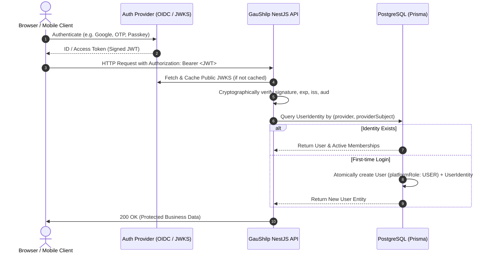

# GauShilp OS — Security Policy & Authorisation Model

**Version:** 1.0 (Step 3: Authentication and Authorisation)  
**Security Level:** High / Multi-Tenant Commercial SaaS  

---

## 1. Authentication Architecture

GauShilp OS uses an **established identity provider integration pattern (OIDC / JWT)** rather than custom password authentication.

### Core Security Rules
1. **Asymmetric Cryptographic Verification**:
   * All bearer tokens are verified using the identity provider's JSON Web Key Set (JWKS).
   * Token claims (`sub`, `iss`, `aud`, `exp`) are **never** trusted without verifying the cryptographic signature.
   * Algorithms are strictly restricted to asymmetric algorithms (`RS256`, `ES256`, `EdDSA`). Symmetric secrets are rejected for provider tokens.
2. **Provider-Independent Boundary**:
   * The backend does not lock into a single vendor (Auth0, Clerk, Supabase, Cognito, or Keycloak).
   * Configuration is resolved at startup via standard OIDC parameters:
     * `AUTH_PROVIDER` (e.g. `oidc`, `auth0`, `clerk`)
     * `AUTH_ISSUER_URL`
     * `AUTH_AUDIENCE`
     * `AUTH_JWKS_URL`
3. **No Secret or Token Leakage**:
   * Database responses and API outputs never return JWTs, provider client secrets, or private keys.
   * Error logs redact authorization headers and credentials.

---

## 2. User Identity & Subject Mapping

### Identity Rules
* **Subject-Based Identity**: Users are mapped by their immutable provider subject (`sub`), not email alone.
* **Account Hijacking Prevention**: An unverified identity cannot attach to an existing account if that account is already linked to another external identity.
* **Privilege Separation**: Newly registered users are assigned `PlatformRole.USER`. The `SUPER_ADMIN` platform privilege can **never** be obtained through client input, tokens, or first-time registration.

---

## 3. Role-Based Access Control (RBAC)

The system enforces five primary roles across two distinct security scopes:

### 3.1 Platform Scope (System-Wide)
* **`SUPER_ADMIN`**: Managed via `user.platformRole` in the database.
  * Access: Platform settings, tenant management, subscription tiers, audit logs, system health.
  * Isolation: Super Admin permissions are completely separate from store memberships. Super Admins do not automatically possess access to individual tenant business operations.

### 3.2 Tenant Scope (Store-Specific)
Managed via `tenant_memberships` in the database. A user's role is strictly bounded to a single tenant:

| Role | Permitted Actions | Prohibited Actions |
|---|---|---|
| **STORE_OWNER** | Full control of own store, team staff, product catalog, orders, and SaaS billing | Accessing other tenants' data |
| **STORE_MANAGER** | Managing catalog, stock/inventory, fulfillment, viewing reports | Billing, store deletion, staff management |
| **STORE_STAFF** | Assigned operational tasks (packing orders, updating fulfillment tracking) | Deleting products, modifying prices, managing team |
| **CUSTOMER** | Shopping, managing personal profile, saved addresses, personal order history | Viewing store administration, accessing other customers' orders |

---

## 4. Multi-Tenant Data Isolation Guards

Tenant isolation is a **release-blocking security requirement**.

1. **Server-Side Membership Validation**:
   * Every tenant-scoped request must pass through `TenantAccessGuard`.
   * Client-supplied tenant IDs (from `x-tenant-id` header or URL parameters) are **never trusted as authorization**.
   * The guard validates whether the authenticated user has an active membership (`status: 'ACTIVE'`) for that specific tenant in the database.
2. **Cross-Tenant Request Rejection**:
   * If a user authenticated for Tenant A attempts to access Tenant B, the request is immediately terminated with HTTP `403 Forbidden`.
3. **Compound Unique Index**:
   * `@@unique([userId, tenantId])` prevents duplicate memberships in the same tenant, while allowing a user to legitimately belong to multiple different stores (e.g. Owner of Store A, Customer in Store B).

---

## 5. Security Regression Tests

The following security tests are automated and execute in CI:
* Cryptographic signature forgery rejection.
* Expired and future token rejection.
* Incorrect issuer and audience claim validation.
* Cross-tenant access rejection (Tenant A user accessing Tenant B).
* Escalation prevention (client input attempting to claim `SUPER_ADMIN`).
* Identity collision and uniqueness verification.

---

## 6. Payment & SaaS Subscription Security Architecture

Financial security and tenant isolation are critical release-blocking requirements:

1. **Strict Separation of Ledgers**:
   * Customer-to-seller product purchases are tracked in `payment_records`, `payment_attempts`, and `refund_records`. Each record is strictly bound to `orderId`, `tenantId`, and customer `userId`.
   * Seller-to-GauShilp platform SaaS billing is tracked independently in `subscriptions` and `subscription_invoices`.
   * A seller's SaaS subscription payment is **never** recorded as or conflated with a customer product payment.

2. **Zero-Trust Client Payment Status**:
   * Client-supplied payment IDs or frontend claims of payment success are **never** trusted as proof of payment.
   * Orders are only marked `PAID` and `CONFIRMED` upon verified provider webhook notification or direct verified provider server-to-server call.

3. **Cryptographic Webhook Verification**:
   * All incoming webhooks must contain a valid cryptographic signature (`x-signature`, `stripe-signature`, etc.).
   * Signatures are verified using HMAC-SHA256 against provider-specific secrets using constant-time comparison (`crypto.timingSafeEqual`) to prevent timing attack vulnerabilities.
   * Requests with missing or forged signatures are rejected immediately with `401 Unauthorized`.

4. **Replay & Idempotency Protection**:
   * Every processed webhook event is persisted in `payment_webhook_events` with a compound unique constraint on `[provider, eventId]`.
   * Duplicate webhook deliveries (retries or replay attacks) are recognized atomically and safely return `200 OK` without duplicating financial state changes.

5. **Late Payment Reconciliation Invariant**:
   * If a customer payment succeeds for an order that was already `CANCELLED` (e.g. customer delayed checkout until after order expiration and stock restoration), the system **preserves stock restoration** and flags the payment as `SUCCEEDED` with `RECONCILIATION_REQUIRED` for refund/audit rather than silently reviving the order.

6. **PCI-DSS Compliance & Sensitive Data Scrubbing**:
   * No raw credit card numbers (PAN), CVVs, expiration dates, or bank credentials are ever received, processed, or persisted by GauShilp OS.
   * Only non-sensitive provider tokens (`providerPaymentId`, `providerSubscriptionId`) and payment methods are stored.

7. **Server-Side Entitlement Checks**:
   * Subscription tier quotas (product catalog size, staff member seats, custom domains, analytics) are strictly enforced server-side via `EntitlementsService`.
   * Client-side UI flags or hidden buttons are never relied upon for subscription tier limits.

---

## 11. Shipping, Fulfilment & Tracking Security (Step 9)

1. **Customer Ownership & IDOR Protection**:
   * Order tracking endpoint (`GET /api/v1/customers/me/orders/:orderId/tracking`) strictly verifies that `order.userId === caller.id`.
   * If an unauthorized customer or stranger queries another customer's order, the API returns `404 Not Found` rather than leaking order existence or delivery address details.
   * Public tracking views sanitize all data, completely stripping out seller-specific fulfillment wholesale costs (`shippingCost`), carrier notes, and margin details.

2. **Tenant Fulfilment Isolation**:
   * All seller fulfilment endpoints (`/api/v1/shipping/orders/ready`, `/api/v1/orders/:orderId/shipments`, `/api/v1/shipments/:shipmentId`) verify active database tenant memberships with role `STORE_OWNER`, `STORE_MANAGER`, or `STORE_STAFF`.
   * Cross-tenant access is rejected with `403 Forbidden`. One artisan store cannot view, fulfill, or alter shipments of another store.

3. **Shipment State Machine Security**:
   * All shipment status transitions are validated against a strict state machine graph.
   * Delivered shipments (`DELIVERED`), returned shipments (`RETURN_TO_ORIGIN`), and cancelled shipments (`CANCELLED`) are terminal.
   * Delivered shipments cannot silently or maliciously be reverted to earlier statuses (`SHIPPED`, `IN_TRANSIT`).

4. **Cryptographic Carrier Webhook Validation**:
   * All carrier webhook notifications (`POST /api/v1/webhooks/shipping/:provider`) must supply an authentic cryptographic signature (`x-signature` or `x-provider-signature`).
   * Signatures are validated against the configured carrier webhook secret using HMAC-SHA256 and constant-time buffer comparison (`crypto.timingSafeEqual`) to prevent timing attacks.
   * Unauthenticated or tampered webhook calls are rejected immediately with `401 Unauthorized`.

5. **Deduplication & Out-of-Order Webhook Safety**:
   * Incoming tracking events are checked against stored `shipment_events` by `(shippingRecordId, status, description, eventTimestamp)` to prevent duplicate history records from carrier webhook retries.
   * If an out-of-order network delayed event (e.g. `IN_TRANSIT`) arrives after a shipment has already been confirmed as `DELIVERED`, the milestone is recorded for historical auditing but does **not** regress the shipment or order status.

6. **Carrier Eligibility & Cargo Integrity**:
   * Packaging weight and dimensions are validated on the server.
   * Special platform handmade goods (sacred cow dung cakes, statues, bulk cow dung wood logs) are screened against carrier guidelines before dispatch (e.g. commercial air freight restricts heavy biomass wood > 10kg without phytosanitary clearance; standard road/surface cargo required).

---

## 12. Notifications, Background Jobs & Transactional Outbox Security (Step 10)

1. **Customer Ownership & IDOR Protection**:
   * In-app notification endpoints (`GET /api/v1/notifications`, `GET /api/v1/notifications/unread-count`, `PATCH /api/v1/notifications/:notificationId/read`, `PATCH /api/v1/notifications/read-all`) strictly restrict access to the authenticated user's `recipientUserId`.
   * Any attempt to read or mark another user's or another tenant's notification as read returns `404 Not Found` without disclosing record existence or metadata.

2. **Decoupling Business Transactions from External Network Providers**:
   * Critical domain transactions (order creation, order cancellation, payment processing, shipping dispatch, subscription updates) **never** make outbound HTTP requests or call third-party email providers within database transactions.
   * Events are written to the `outbox_events` table within the same PostgreSQL transaction, guaranteeing atomic persistence without dual-write inconsistency.
   * Asynchronous background workers (`OutboxProcessor`, `JobProcessor`) process these events outside the business transaction lifecycle.

3. **Fault-Tolerant Outbox Insertion (Zero Business Transaction Rollback)**:
   * `OutboxService.createEvent` catches and handles event-creation failures gracefully so that a secondary notification failure can never abort or roll back an already committed order or payment transaction.

4. **Sanitization of Notification Payloads**:
   * In-app notification titles, messages, and `data` JSON payloads never store sensitive cardholder data, banking credentials, authentication secrets, or internal merchant wholesale margins.
   * Only non-sensitive operational metadata (e.g. `orderId`, `orderNumber`, `trackingNumber`) is stored.

5. **Deduplication & Anti-Spam Safeguards**:
   * A 60-second in-memory fingerprint window suppresses duplicate alert creation to the same recipient, preventing user alert fatigue during event retries or duplicate deliveries.

6. **Bounded Retries & Dead-Letter Safety**:
   * Outbox events use bounded retries with exponential backoff (`delayMs = Math.pow(2, retryCount) * 2000`).
   * Events exceeding `QUEUE_MAX_RETRIES` (default: 5) transition to `DEAD_LETTER` with structured error diagnostics, preventing worker poison-pill crashes and enabling safe administrative audit and replay.

---

## 13. Cloudflare R2, Secure File Uploads and Object Storage Security (Step 11)

1. **Zero-Trust Client Input & Deterministic Object Keys**:
   * Filenames, extensions, MIME types, and client-suggested paths are never trusted directly.
   * Path traversal sequences (`../`, `..\`) and forbidden characters are stripped by sanitization.
   * Object keys are generated strictly on the server using deterministic paths:
     - Tenant assets: `tenants/{tenantId}/{purpose}/{uuid}.{ext}`
     - User documents: `users/{userId}/{purpose}/{uuid}.{ext}`
   * Clients cannot choose bucket names, directory hierarchies, or overwrite existing objects.

2. **Short-Lived Presigned Upload & Download URLs**:
   * Storage credentials (`OBJECT_STORAGE_ACCESS_KEY_ID`, `OBJECT_STORAGE_SECRET_ACCESS_KEY`) are never sent to browsers or clients.
   * Direct uploads use presigned `PUT` URLs generated using AWS SDK S3 Presigner (`@aws-sdk/s3-request-presigner`) with a strict 15-minute expiration window (`UPLOAD_URL_EXPIRATION_SECONDS=900`).
   * Private documents use short-lived presigned download `GET` URLs (15 minutes). The underlying bucket remains private and does not allow anonymous public reads.

3. **Two-Phase Upload Lifecycle & Quarantine State**:
   * Uploads are initialized in `PENDING` status.
   * Files remain unverified and inaccessible to public storefronts until the client calls `/api/v1/files/:fileId/complete`.
   * The backend independently inspects the uploaded object in storage (`headObject` + `getObject`).
   * If validation fails, the record transitions to `REJECTED`, the binary is deleted from object storage immediately, and no public URL is ever issued.

4. **Multi-Layer File & Content Validation**:
   * **Magic Byte Analysis**: File binary headers are validated against signature bytes:
     - JPEG: `FF D8 FF`
     - PNG: `89 50 4E 47`
     - WebP: `52 49 46 46` ... `57 45 42 50`
   * **Sharp Image Decoding**: Sharp decodes the full image structure, confirming valid geometry and rejecting disguised executables, HTML polyglots, and corrupt headers.
   * **Dimension and Size Limits**: Images exceeding maximum dimensions (e.g. 8192x8192) or file size limits (10MB default) are rejected.
   * **Execution Prevention**: The asset storage domain is strictly configured for static media delivery with appropriate `Content-Type` headers. HTML, SVG, JavaScript, PHP, or ELF/PE executables are unconditionally rejected.

5. **Tenant Scoping & Cross-Tenant Attachment Protection**:
   * Every file upload intent requires tenant validation. A user must possess an active `STORE_OWNER` or `STORE_STAFF` membership in the specified tenant.
   * File completion, metadata retrieval, and deletion enforce strict tenant and user ownership.
   * Product and Store services verify that attached media URLs correspond to verified files belonging to the current tenant. Cross-tenant image or logo attachment is rejected with `403 Forbidden`.

6. **Active Reference Protection**:
   * Prior to deleting any stored file, the backend verifies whether its `publicUrl` is actively referenced in any product `images` array or store `logoUrl`/`bannerUrl`.
   * If actively referenced, deletion is aborted with `409 Conflict`, preventing broken storefront images or dangling references.

7. **CDN Architecture & Cache Poisoning Defense**:
   * Public asset URLs are generated via configurable `PUBLIC_ASSETS_BASE_URL` pointing to Cloudflare CDN.
   * Object keys contain unique UUIDs (`{uuid}.{ext}`), ensuring immutability and preventing cache poisoning across tenants or file revisions.
   * Private assets are never mapped to public CDN URLs and are accessible only through short-lived presigned URLs.

---

## 14. Super Admin Access Control & Platform Security (Step 12)

1. **Platform-Level Super Admin Boundary**:
   * Platform administration is strictly segregated from store tenant administration.
   * Administrative APIs (`/api/v1/admin/*`) are guarded by `@UseGuards(JwtAuthGuard, PlatformRolesGuard)` and `@Roles(PlatformRole.SUPER_ADMIN)`.
   * Neither store roles (`STORE_OWNER`, `STORE_MANAGER`, `STORE_STAFF`) nor customer roles possess platform administrative privileges.
   * Requests from unauthenticated callers return consistent `401 Unauthorized`. Authenticated non-Super Admins receive `403 Forbidden`.

2. **Prohibition of Self-Promotion & Registration Segregation**:
   * Public registration and standard user onboarding flows unconditionally assign `platformRole: USER`.
   * Ordinary user profile update endpoints cannot modify `platformRole` or `status`.
   * Promotion to `SUPER_ADMIN` requires direct database administration or offline provisioning by existing platform operators.

3. **Self-Lockout Defense & Peer Administrator Protection**:
   * Super Admins are strictly prohibited from suspending their own accounts (`actorUser.id === targetUserId` triggers `400 Bad Request`), preventing accidental platform-wide lockout.
   * Standard administrative APIs cannot suspend other `SUPER_ADMIN` accounts (`403 Forbidden`), preventing rogue privilege takeovers among administrators.

4. **Backend Enforcement of Tenant Suspension**:
   * Tenant suspension is enforced at the core backend authorization boundary (`TenantAccessGuard`), not merely represented as a passive UI flag.
   * When a tenant is marked `SUSPENDED`:
     * Store owners, managers, and staff are immediately blocked from executing store mutations, inventory updates, product management, or file operations (`403 Forbidden`).
     * Existing tenant data is preserved intact (no destructive data deletion on suspension).
     * Platform Super Admins retain read and status-modification access to investigate and reactivate the tenant.

5. **Backend Enforcement of User Account Suspension**:
   * When a platform user account is marked `SUSPENDED`:
     * `JwtAuthGuard` intercepts the token claims, checks the database user status via `IdentityService`, and terminates the request with `403 Forbidden`.
     * Suspended users cannot authenticate, place orders, modify addresses, or manage stores across any tenant.

6. **Immutable Audit Logging & Secret Scrubbing**:
   * All sensitive administrative actions (tenant suspension/reactivation, user suspension, privileged subscription changes) synchronously write to the `audit_logs` table.
   * Every audit record captures: `actorUserId`, `action`, `targetType`, `targetId`, `tenantId`, `reason`, `metadata`, `ipAddress`, and `userAgent`.
   * Metadata sanitization scrubs any keys matching `password`, `token`, `secret`, `authorization`, `creditcard`, `apikey`, or sensitive authentication payloads before database insertion.
   * Audit records are append-only; standard users and store staff have no read or write access to audit logs.

7. **Operational Telemetry & Secret Isolation**:
   * System health monitoring endpoints (`/api/v1/admin/health/*`) report only necessary operational metrics (process memory, node uptime, queue dead-letter counts).
   * Database connection strings, passwords, Redis URLs, R2 secret access keys, and environment variables are strictly excluded from all health check responses.
   * The PostgreSQL connectivity probe uses an isolated lightweight query (`SELECT 1`) with an explicit 3000ms promise race timeout.

8. **Database Aggregation & Financial Separation**:
   * Platform analytics queries use database-level aggregations (`_sum`, `_avg`, `_count`) rather than loading raw order collections into Node.js process memory.
   * Gross order value (GMV) is strictly distinguished from verified collected payment revenue.
   * Unverified, pending, or failed customer payments are excluded from collected revenue.
   * Customer-to-seller marketplace revenue is reported separately from platform SaaS subscription revenue.
   * Maximum query window is restricted to 365 days; inverted date ranges are rejected (`400 Bad Request`).

---

## 15. Security Headers, Rate Limiting & Backup Integrity Controls (Step 14)

1. **Mandatory HTTP Security Headers**:
   * Every incoming HTTP request passes through `SecurityHeadersMiddleware`.
   * `X-Content-Type-Options: nosniff` strictly blocks MIME confusion and sniffing attacks.
   * `X-Frame-Options: SAMEORIGIN` blocks iframe embedding on foreign domains (anti-clickjacking).
   * `X-XSS-Protection: 0` disables buggy browser XSS audits in favor of strict CSP.
   * `Strict-Transport-Security: max-age=31536000; includeSubDomains` enforces TLS in production.
   * `Referrer-Policy: strict-origin-when-cross-origin` restricts cross-origin referrer leakage.
   * `Permissions-Policy` restricts unneeded client hardware capabilities.
   * The `x-powered-by` header is permanently disabled on the Express server instance.

2. **Distributed Rate Limiting**:
   * Sensitive endpoints (e.g. login, payment initiation, admin triggers, backup drills) are protected by `@RateLimit({ limit, ttlSeconds })`.
   * Enforced via `RateLimitGuard` backed by distributed Redis or in-memory cache.
   * Returns standard `X-RateLimit-Limit`, `X-RateLimit-Remaining`, `X-RateLimit-Reset` headers.
   * Request floods return HTTP 429 Too Many Requests with explicit `Retry-After` seconds.

3. **Backup Encryption & Separation Controls**:
   * All database backups are encrypted at rest using AES-256-GCM envelope encryption before leaving the application boundary.
   * Each backup generates a fresh random 96-bit IV and produces a 128-bit authentication tag.
   * Unencrypted SHA-256 integrity checksums are computed prior to encryption and saved in durable manifests.
   * Backup storage is isolated in dedicated cloud buckets (`BACKUP_STORAGE_BUCKET`) using separate credentials.
   * Accidental or malicious deletion of live application media cannot purge recovery copies.

4. **Retention Policies & Last-Backup Invariance**:
   * Automated 30-day retention pruning deletes expired backups.
   * The pruner is mathematically guaranteed to preserve the single latest verified backup, preventing total backup loss if jobs fail or environments are suspended.

5. **Non-Destructive Restoration Testing**:
   * Restore drills (`restoreDatabase`) run in dry-run verification mode unless an isolated, dedicated test client is explicitly supplied.
   * Live production databases are never overwritten during restore validation drills.
